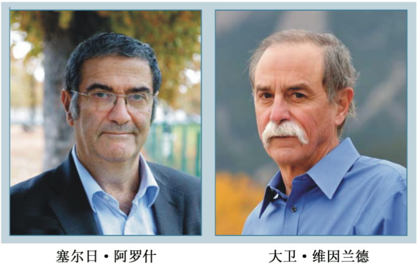
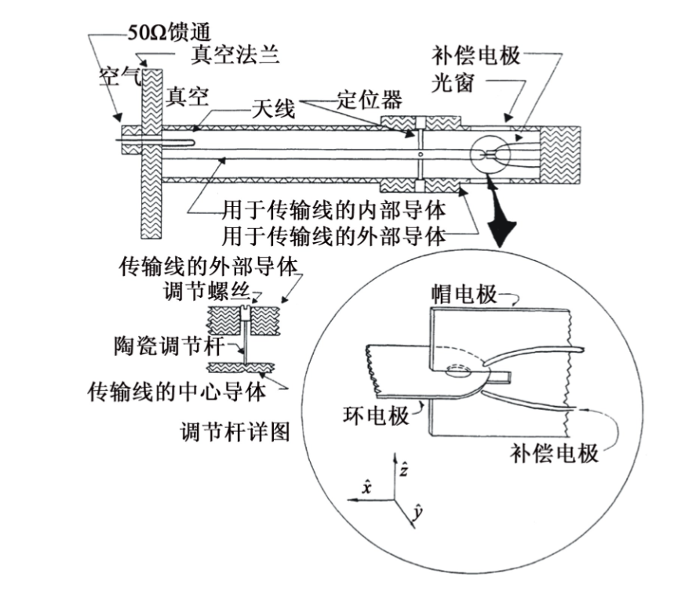
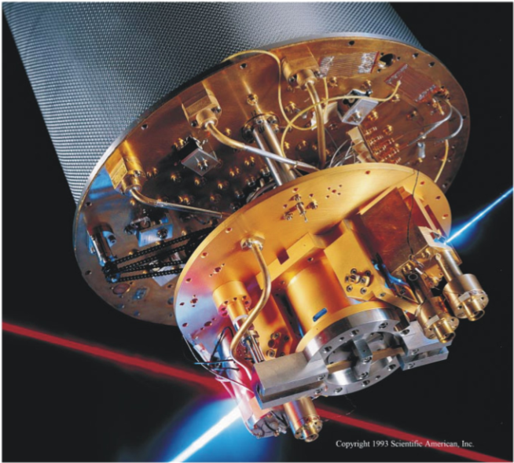
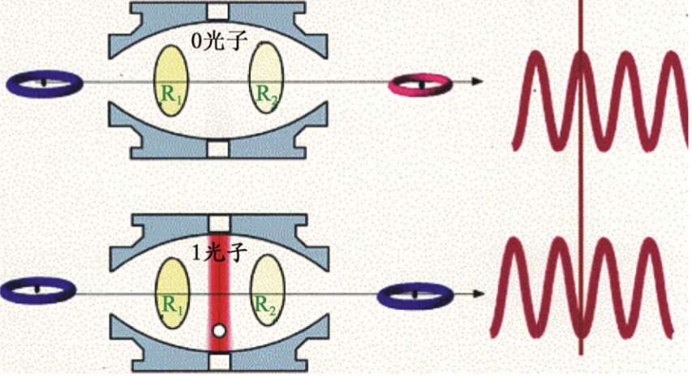
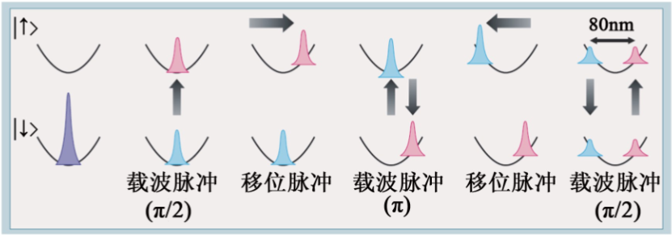

物理·41卷 (2012年)12期 诺贝尔物理学奖评述

# [单个量子态的操纵和测量：2012年诺贝尔物理学奖述评*](https://wuli.iphy.ac.cn//article/id/51883)

高克林¹，张天才²

(1 中国科学院武汉物理与数学研究所 波谱与原子分子物理国家重点实验室 武汉 430071)
(2 山西大学光电研究所 量子光学与光量子器件国家重点实验室 太原 030006)

**摘要**  塞尔日·阿罗什和大卫·维因兰德获得了2012年诺贝尔物理学奖。他们独立地发展了突破性的实验方法，成功地实现了对单个量子态的测量和控制，由此展示了量子世界的基本特性。同时促进了基于量子技术的量子信息和原子钟的发展。

**关键词**  量子系统，量子信息，原子钟

Physics Nobel Prize in 2012: Measuring and manipulation of individual quantum systems

GAO Ke-Lin¹，ZHANG Tian-Cai²

(1 State Key Laboratory of Magnetic Resonance and Atomic and Molecular Physics, Wuhan Institute of Physics and Mathematics,
Chinese Academy of Sciences, Wuhan 430071, China)

(2 State Key Laboratory of Quantum Optics and Quantum Optics Devices, Institute of Opto-Electronics, Shanxi University, Taiyuan 030006, China)

**Abstract**  Professor Serge Haroche and Professor David J. Wineland have been awarded the 2012 Nobel Prize in Physics. They have independently invented and developed ground-breaking experimental methods for measuring and manipulating individual quantum systems while preserving their quantum-mechanical nature. Their work demonstrates very fundamental behaviour of quantum systems under full control, and underpins quantum technologies relevant to quantum information and atomic clocks.

**Keywords**  quantum systems, quantum information, atomic clock

* 国家重点基础研究发展计划（批准号：2012CB821300；2012CB921601）、国家自然科学基金（批准号：11034009；11125418）资助项目

2012-11-25收到

Email: klgao@wipm.ac.cn
Email: tczhang@sxu.edu.cn

2012年10月9日，本年度诺贝尔物理学奖揭晓。瑞典皇家科学院诺贝尔奖评审委员会将奖项授予原子分子和光物理领域的两位科学家——法国物理学家塞尔日·阿罗什（Serge Haroche）与美国物理学家大卫·维因兰德（David J. Wineland），以表彰他们“提出了突破性的实验方法，使测量和操控单个量子系统成为可能”。

过去数十年来，这两位实验物理学家主要围绕原子（离子）和光子的操控和测量，在光与物质作用最基本的层面上，即在确定性的单个粒子的水平上，为我们展示了微观世界中丰富多彩的量子行为。

在两位获奖者（图1）中，Serge Haroche 1944年生于摩洛哥的卡萨布兰卡，1977年在巴黎第六大学（皮埃尔与玛丽·居里大学）获得博士学位，曾任职于法国国家科学中心和法国综合理工大学，现为法国科学院和巴黎高等师范学院教授。David J. Wineland 1944年生于美国密尔沃基，1970年在哈佛大学获得博士学位，1970—1975年在华盛顿大学做博士后工作，现任职于美国国家标准与技术研究所和科罗拉多大学博尔德分校。

  

图1  2012年诺贝尔物理学奖得主（图片来源：Physics Today, December 2012: “Physics Nobel honors pioneers in quantum optics”一文）

创立于20世纪的量子力学导致了原子能、激光和半导体等技术的出现，推动了科学和物质文明的进步。量子力学描述了微观世界的行为。这个微观世界远离我们的现实。我们大部分人总是觉得这门学问和它展示的各种怪异现象高深莫测：叠加态、波包坍缩、量子纠缠、单粒子的非定域、Bell不等式、量子隐形传送、薛定谔猫等等，这些现象在我们生活的经典世界不会发生。300多年前，为描述宏观世界，牛顿建立了牛顿力学，发现了万有引力定律，把地上发生的事情和天体的运行变化规律统一了。这就是说，牛顿定律可以适用于比我们周遭环境尺度扩大100亿倍的范围，差不多就是太阳系的尺度。那么，牛顿定律似乎理所当然地也应该适用于比我们周遭的环境尺度缩小100亿倍的世界，也就是一个原子的内部。但是实际情况不是这样。

为什么经典物理学不适用于微观世界？一个原子跟一块石头不都是服从牛顿力学规律自由下落吗？研究一个原子（离子）或者光子与研究一块石头有两点本质的不同：第一，描述这两个对象的语言不同。我们可以用位置、速度、质量、体积、化学成分等描述一块石头，但是我们不能用类似这样的经典物理量很好地描述一个原子或者一个光子的行为，我们必须用量子态以及服从薛定谔方程的量子态的变化来描写它们；第二，测量或者观察这两个对象对其产生的影响不同。对一块石头看一眼不会对它有什么影响，你可以精确地测量它的大小、位置、速度等等。但是你很难（甚至根本做不到）对一个原子或者光子看一眼而对它没有什么影响。恰恰相反，对一个微观客体的观测会给它带来巨大的扰动甚至破坏。

牛顿力学描述的经典世界具有确定性的轨道和位置，而量子力学描绘的微观世界具有不确定性或者说具有随机性。由量子态描写的微观世界与宏观经典物理很不相同，存在量子相干性和量子叠加态：一个量子系统可以有多重形态。奥地利物理学家薛定谔为此提出的“猫”态（称为薛定谔猫）就是一个典型的例子：一只猫可以处于“活着”和“死了”的叠加状态，当我们希望通过观测确认猫的死活状态时，量子态会“塌缩”到其中的本征态“死”或者“活”上。但是这样的现象在现实生活中我们没有看到，也违背我们的直觉，它真的存在吗？

自从量子力学建立以来，物理学家总是希望通过某些物理系统，在实验上展示由量子力学描述的各种现象，把那些停留在书本上的模型和各种各样的量子态以及它们不同于经典世界的行为都呈现出来。这一方面可以帮助我们深刻理解量子物理的内涵，另一方面，又可以通过这些有别于经典物理的特殊性质（比如量子纠缠、亚真空噪声等），获得某些超乎想像的新的应用。这些应用包括量子信息、精密测量等，它们已经被证明可以突破经典物理学给我们带来的若干制约，包括量子保密、量子计算以及超越量子极限的灵敏测量等等。

有各种各样的物理系统可以呈现量子物理的许多现象，但是 Haroche 和 Wineland 相信利用组成我们这个世界的基本成分，也是我们最熟悉的部分——原子和光子为对象来展示这些现象，能更好地展现量子力学的本质。其中一个重要的原因是，来自天然的原子和光子非常纯净，它们之间的作用早就作为教科书中的标准模型搞得很清楚了。量子电动力学预言的结果（比如电子的固有磁矩与实验的偏差），到目前为止也是物理学中最精确的预言。从历史上看，自普朗克、爱因斯坦开始，量子物理的建立过程正是从研究光的量子行为开始的，包括黑体辐射、光电效应等等。激光这种相干光源的诞生更是提供了一种强有力的工具，可以帮助我们准确地对准原子的某个能级，实现强的作用，从而完成对原子（离子）的精确操控。

由于量子现象本身的脆弱性，原子与光子自身的“干净”是一方面（它们已经得到了保证）。要保持好的相干性，也就是要保持量子态持续的时间，原子和光子所处的环境非常重要，要求它们所处的环境必须非常“干净”。光子之所以能够穿越茫茫宇宙飞行亿万年到达地球，就是宇宙中的真空环境非常“干净”，不与光子和其他粒子作用才能实现的。但是我们在现实的环境中很难做到，你关掉办公室的灯，满屋子的光子就会在一瞬间消失，那是因为我们的环境太“脏”了。人们不可能构建一个太大的系统使其保持良好的相干性。实际上，一个系统中的粒子数越多，越容易因为与外界的接触和内部的作用发生衰退（decay）。因此，建立一个尽可能与外界环境隔离的、相对孤立的单粒子系统，对降低原子（离子）和光子组成的量子系统与环境之间的相互作用、提高系统的相干性，是非常重要的。对单个原子（离子）粒子的确定性操控也来自另外一种动机：长期以来，一直存在一些反对和质疑原子论的观点，像马赫、奥斯瓦尔德以及薛定谔等，他们声称“没有人看见过单个孤立的原子”。薛定谔指出：“我们从来没有用一个电子、原子或者其他分子做过实验。在构想的实验中，我们的假设总是导致可笑的后果……” [1]。因此，很长时间以来，寻求一个孤立或近似孤立的二能级系统，使其能够长时间处于特定的量子态，成为人们演示量子现象的一个梦想。

上个世纪80年代，Haroche 和 Wineland 就开始单粒子操控方面的实验研究。他们在实验上必须克服两个主要困难：
（1）把单个粒子孤立出来； （2）避免测量对粒子的干扰。解决第一个问题需要用到激光冷却和操控原子的方法 [2]，解决第二个问题需要量子非破坏测量的方法 [3]。两位科学家及其领导的小组以单个光子、原子和离子为对象，经过几十年的努力，展示了克服上述困难的巧妙的实验技术和方法，完成了一系列量子操控和测量方面的杰出工作，帮助我们感受到了那些发生在微观世界的抽象的量子现象的真实存在。

如何制备一个量子体系并把该系统与环境隔离起来，成为一个单量子系统？

物理学家发明了各种方法用以冷却势阱中的单个粒子，并用激光控制它们的状态。一种方法是使用电磁场囚禁单个离子，另一方法是用激光和磁场构成的磁光阱俘获单个中性原子。对于光子来说，则需要构建一个特殊的谐振腔，把光子囚禁起来。

Wineland 的主要工作是围绕囚禁离子开展的。囚禁离子是利用具有特定构型的静电、静磁和射频场将带电离子约束在超高真空中，使被研究的原子体系处于几乎孤立的不受外界“干扰”的环境，特别是单离子的囚禁，可以避免碰撞效应的影响，获得很长的囚禁时间，以便“观察”。该系统是研究原子特性的理想系统（图2）。德国科学家保罗（W. Paul）和美国科学家德默尔特（H. G. Dehmelt，是 Wineland 的博士后导师）因“发展离子阱技术”而获得1989年诺贝尔物理学奖。

  

图2  囚禁 9Be⁺ 的共轴耦合射频（Paul）阱（见 Wineland 小组发表的文章：Phys. Rev. A, 1995, 51: 3112）

在阱中的离子的运动可能导致由 Doppler 效应引起的微波谱和光谱的谱线移动和增宽，使我们很难控制原子和精确测量原子的光谱。可以利用正在发展的激光技术来调节离子的运动状态，精确操纵原子内部的能级，使电子非常准确地在不同原子能级之间跃迁。Wineland 和 Dehmelt 以及 Hänsch 和 Schawlow 于 1975 年同时提出采用激光冷却单个原子/离子的思想 [4]。激光 Doppler 冷却的基本思路是：对一个两能级系统的离子，可根据多普勒冷却的机理，利用散射力进行冷却。当冷却用的单色激光频率略低于离子跃迁共振频率，并且离子向着激光方向运动时，正的多普勒频移会使离子与激光发生共振相互作用，产生跃迁，即离子从基态跃迁到激发态。而处于激发态的离子会自发辐射回到基态，光子以等几率各向发射，平均不损失动量，总的结果是原子减速。其极限温度由跃迁的自然线宽或反冲速度决定。此时离子大约处在其运动量子态的第一激发态。而当需要进一步冷却时，可采用边带冷却的思想（见 Wineland 等人发表的文章：Physics Today, 1987, (6): 34）：当离子的谐振运动频率大于离子激发态的自发辐射的频率时（强囚禁条件），可以观察到由 Doppler 效应引起的边带。如果激光对准其低的（红）边带，离子吸收能量跃迁到激发态，然后自发辐射，因而损失能量，导致离子能量减少。由于离子的运动态是量子化的，则每次辐射的结果是离子的主量子数减少一个，这样反复多次可使冷却离子处于量子力学的基态。
1978 年，Wineland 小组在离子阱中首次演示了 Mg⁺ 的激光 Doppler 冷却 [5]。随后，Neuhauser 等人在离子阱中实现了 Ba⁺ 的激光 Doppler 冷却 [6]。1988 年，Wineland 小组在 Paul 阱中将单个 198Hg⁺ 冷却到质心运动基态 [7]。单个离子的囚禁和超冷离子的实现，最终获得了处于“静止状态”的孤立体系。同时为了扩展囚禁离子数目，也可采用线形离子阱把几个离子囚禁在阱的中心轴线上。囚禁冷却的离子具有所谓的“内态”和“外态”：前者为离子的电子态，后者为离子在阱中运动所具有的振动态。这些能级可以通过激光激发产生强烈光散射的光学转换而观测。离子的内部状态可以通过观察量子跃迁而确定 [8]。对于一个三能级体系的离子，往往存在激发态和亚稳态，并有共同的基态。而它们到基态的跃迁几率很不相同，从激发态到基态的跃迁为强跃迁，激发态的寿命往往是 10⁻⁸ s，即在 1 s 的时间间隔中辐射 10⁸ 个光子；而亚稳态的寿命则是相当长的，约为秒的量级，这是相当弱的跃迁。在实验中，往往通过观察从激发态到基态的跃迁来判断弱跃迁的发生。如果用激光驱动离子的弱跃迁，一旦离子被激发到亚稳态，所观察的强跃迁信号就马上消失了。这样即使是较低的光子接收效率也能实现探测效率接近于 100% 的离子亚稳态跃迁探测。要确定孤立离子内态还可利用微波—光学双共振实验，完成孤立单离子的禁戒跃迁测量等。离子的光谱同时可以用光电倍增管或用 CCD 相机观测。

与 Wineland 利用光子来研究原子不同，Haroche 的主要工作是利用原子来研究光子。他也是在上个世纪80年代就开始了这方面的工作，其研究领域主要是腔量子电动力学（cavity quantum electrodynamics，CQED）。这项研究主要是把原子置于光学腔或者微波腔内，观察在受限空间，即在被改变的真空环境下（相比较于自由空间），原子的辐射行为，也就是把原子与外部环境隔离起来。原子的自发辐射会因为环境的改变而抑制或者增强，这是 Kleppner 等人先前观察到的现象。20世纪80年代中期，Haroche 就开展了微波区光放大的研究。

由于微波的频率比光频率大约要低 4—5 个量级，因此，与光频区几十微米的腔相比，Haroche 构建的微波腔（图3）达到 2.7 cm。这个腔由超导材料 Nb 制成，被冷却到 0.8 K 左右。之所以要保持在如此低的温度下工作，是为了避免背景黑体辐射发出的微波光子的干扰。他们采用非常好的镜子，从而使微波光子（频率为 51 GHz 左右）的反射率非常高，一个光子在耗散掉之前，可以在腔内来回反射 7 亿多次，存活时间达 130 ms。完成这个任务相当困难，作为比较，普通镜片构成的厘米长度的腔，光子只能存活 ns 量级。

  

图3  Haroche 的实验装置（包括原子初态的制备（左侧）、超导铌腔（中部），以及探测部分（右侧），整个装置处于 1 K 的液氦温度下）[9] 

碱金属原子的基态与第一激发态之间的跃迁波长一般处于近红外，光子的能量比较高，无法与微波光子发生作用。那么有什么样的原子可以充当此重要的角色呢？Rydberg 态的原子具有很大的电偶极跃迁矩阵元，与腔的耦合作用很强，其次，能级寿命较长，从而自发辐射率很低，能确保系统运转在强耦合状态。为此，Haroche 的做法是把原子先制备到 Rydberg 态，即把原子激发到高的能态（即主量子数很大的能级）。原子从 n = 50 到 n = 51 之间的跃迁频率正好与腔内的微波光子频率（51 GHz）一致。实际上，该小组最终使一个原子和一个光子之间的作用强度达到约  $\Omega$ = 314 kHz。该作用强度描述了原子与微波腔交换光子的快慢，也就是平均每秒钟原子与腔交换约 30 万个光子。这个速度远远大于光子和原子本身的衰减。由于原子与腔内光子作用很强，原子和光子，也包括没有光子的空腔，实际上形成了一个不可分割的纠缠态：

$$
|\Psi(t)\rangle = \cos(gt/2)|e,0\rangle - i \sin(gt/2)|g,1\rangle
$$

式中的 t 代表相互作用时间。状态 $|e,0\rangle$ 和 $|g,1\rangle   $ 分别表示原子处于激发态 n = 51、腔内没有光子，以及原子处于基态 n = 50、腔内有一个光子。由于原子与腔之间的相互耦合是如此强烈，以致于一个原子进出腔或者一个光子进出腔时，都会对对方产生巨大的影响。实际上正是利用这种影响完成原子和光子的测量。

在图 3 所示的 Haroche 研究组使用的核心装置中，主要包括原子的制备（左下部位）。由于原子与腔的耦合时间是一个重要参数，而这个时间是由原子飞越腔的速度决定的，因此一开始需要一个速度选择的装置，同时需要把原子制备到特定的初始状态（红色光线，见《物理》网刊彩图，下同）。随后原子进入位于图3中心部位的超导铌腔，原子与腔耦合形成叠加态。图3中的右侧部分为探测器。不同的原子叠加态穿越腔引起的变化不同，出来的状态不一样。在通常情况下，是将原子共振频率与腔场的频率故意调整到稍稍不一致，这样原子不吸收光子，但是它的能级会因为 Stark 效应（有失谐的情况）而发生一点移动，反过来也会引起腔内微波场的位相变化。这个过程跟原子一开始所处的状态有关。完成这一切的前提是光子（腔）与原子的耦合必须足够强，使彼此的影响很大。打个比方：这时的原子和光子就像关系密切的一对夫妻，而谐振腔就相当于他们的家。显然，这三者之间任何一个出现变故，都会对夫妻双方产生巨大的影响。我们通过丈夫的一点表情就知道妻子的心思，更不用说妻子的一场大病对丈夫的影响了。而普通的环境类似于熙熙攘攘的火车站，虽然人与人之间也在交流碰撞，但是就算某一个人乘车离开了，其他人也会浑然不觉，毫无变化。

  

图4 单光子的量子非破坏测量 [10] 

Haroche 小组把制备好的原子一个一个地穿越腔，通过大量的测量，就能够获得原子与腔内光子作用的信息。对单个光子的量子非破坏测量是 Haroche 和他的合作者在 1990 年提出的。如图4所示，制备好的原子（左侧蓝色圆环）进入腔内，R₁ 和 R₂ 分别表示经典光脉冲激发制备和测量原子的状态的系统。穿越腔的原子的状态会受到腔内是否存在光子的影响（不同的颜色表示）。通过飞越腔的原子状态的变化，在没有破坏腔内光子的前提下，把腔内是否存在光子的信息传递出来，即实现了测量腔内有一个光子但没有破坏它的目的，从而克服了我们前面提到的困难。Haroche 小组在 1999 年完成了这个实验 [10]，后来他们进一步对单个光子从产生到消失的整个过程进行了研究 [11]，这一切都是在一种所谓量子非破坏的条件下完成的。对单个光子的产生、存在和消亡过程的无破坏测量，使我们第一次“偷窥”到了最脆弱的单个量子客体的行为。

显然，单个原子和光子的操控和测量为我们开启了通向量子世界的一个窗口。

Haroche 小组通过操控单个原子辐射的单个光子，把光子一个一个“码”起来，在实验上获得了具有确定粒子数的 Fock 态光场，这种非经典光场长期被人们用来作为表征各种量子态的“基矢”。从目前看，我们离实现这个“基矢”还有相当距离，但 Haroche 的研究为此迈出了重要一步 [12]。通过该系统，他们观察到了 Jaynes–Cummings 模型（简称 JC 模型）理论中预言的许多量子效应，如 “Rabi 振荡”、“崩塌—复苏” [13] 以及原子辐射的腔增强效应 [14]，并在单量子水平上研究了量子退相干 [15]、量子纠缠 [16] 等。

在 Haroche 开展对微波腔与原子相互作用研究的同时，德国马普研究所量子光学实验室的 Walther 小组实现了单原子微波激射器。光频区的工作主要代表是加州理工学院的 Kimble 研究组和德国马普所的 Rempe 研究组。Kimble 小组在 1992 年实现了光频区单个原子与微光学腔的强耦合。他们完成了一系列开创性的工作，这些工作与同一时期冷原子技术和量子信息技术结合起来，推进了原子和光子测量和操控的研究，使基于单原子—腔的强耦合系统成为量子光学中研究物质与场（包括真空腔）相互作用的重要平台。这方面的研究激发了后来其他系统（如电路量子电动力学、光力学（optomechanics）以及表面等离激元（SPP）等方面）的研究。

Wineland 利用边带冷却将质心运动冷却到运动的基态，从而使超冷离子呈现出明显的量子性质，由此可以验证量子力学的若干现象。可用适当的激光序列激发不同的基频、上边带和下边带跃迁，制备其他高阶的 Fock 态；采用空间均匀的经典驱动场或加上运动驻波场的方法获得了相干态；用两束拉曼光激发基态，实现了压缩态 [17]；并利用叠加、位移、交替作用的激光脉冲组合作用于振动零点态，产生了薛定谔猫态（图5）[18]，即一个离子同时在两个地方（一个是活的态，一个是死的态）。

如何产生和测量这个介观的“猫态”呢？Wineland 小组利用 Be⁺ 离子内态（电子的基态超精细能级）和外态（运动振动态）来实现态的制备和激光操作。

首先，把被囚禁并冷却到运动基态 $|0\rangle$ 的 Be⁺ 制备到基态的超精细能级的一个态 $|↓\rangle$ 上，采用一个 π/2 的激光脉冲，使离子处于超精细结构两个能级的叠加态。随后用一个脉冲选择激发 $|↑\rangle$ 态，产生了包含振动态 $|α\rangle$ 的纠缠态：$|↓\rangle|0\rangle + |↑\rangle|α\rangle$，此时一个波包在阱中有运动，而另一个波包则处于几乎不动的状态。此时若再加一个 π 脉冲，使第二个波包也在阱中运动起来，进入振动态 $|α'\rangle$，则此时的离子处于可区分不同相位的两个波包的叠加状态：$|↓\rangle|α'\rangle + |↑\rangle|α\rangle$。当两个波包相位差超过波包尺寸（80 nm）的 10 倍时，两个态是可区分的。最后用一个 π/2 的激光脉冲，使两个波包（处于离子超精细结构不同态）产生依赖相位的干涉，再用荧光探测得到了两个振子态的相干特性。此后还用重构和量子层析（quantum tomography）技术，在位置-动量空间测量了负值的 Wigner 函数（此为典型的量子系统的非经典判据，是薛定谔猫态的典型特征）[19]。这些工作为研究单量子态的性质和演化提供了很好的实验例证。

  

图5 囚禁 ⁹Be⁺ 的薛定谔猫态 [18] 

单量子系统的操控以及这些量子现象，除了可以帮助我们认识量子物理展示的复杂多样性外，还有两个方面的实际应用：一个是量子信息，另一个是精密测量。

量子信息是量子物理与信息科学结合的交叉学科。量子计算机是基于量子力学规律运行的新型计算机，具有许多传统计算机不具有的特性。尽管其优势和潜力还远远未被认识和发掘，但它在解决某些特殊问题方面已显示出巨大的威力，如大数因子分解和数据搜索。量子计算由于其全新的物理概念和具有经典计算机无法比拟的优点，早已激发起人们的研究热情。

而如何寻找合适的量子体系是实现量子计算的关键和急需探索的问题。1995 年，Cirac 和 Zoller 提议用囚禁离子构建量子计算机 [20]：利用离子阱中的超冷离子的内部能级作为量子位，利用离子间的库仑力相互作用耦合的集体振动（声子振动）实现“量子位门操作”，用激光将离子的内态与其质心振动态纠缠，并借助电子搁置方法（量子跳跃）实现信息的读出。由于质心振动态为各个离子所共有，所以离子可以通过质心振动态实现相互间的纠缠。Wineland 小组于 1995 年利用冷却到零点能的单个 Be⁺，成功地演示了量子逻辑门 [21]；1998 年，实现了两个超冷离子的单重和三重 Bell 纠缠态，后来拓展到四离子纠缠，展现了囚禁离子用于量子计算的可扩展性 [22]。

Haroche 小组也用超导微波腔量子电动力学系统演示了若干量子信息过程，如光子量子比特的存储以及将光子和原子作为“量子比特”的量子逻辑门操作等。1997 年，他们实现了单光子量子比特的存储。他们把真空和单光子构成的量子叠加态作为一个量子比特携带到一个二能级原子上，该原子进入高品质腔中与腔发生作用，在经历了一段时间延迟以后，光子比特信息能够被成功地转移到第二个原子上。量子比特信息在腔内被存储的时间达到 100 μs 左右 [23]。这一实验表明，借助于腔与原子的耦合，单光子量子态可以作为一个中介，在原子之间传递量子信息。随后，他们进一步利用相同的系统，演示了量子位相门的相干操作 [24]。该位相门主要基于原子的受控 Rabi 振荡，利用原子与场相互作用形成的纠缠态的位相移动，在实验上是通过调整原子与腔的频率失谐来完成的。他们成功地演示了位相门的相干操控，成功率达到 90%。该实验是迈向多比特纠缠和量子网络的重要一步。

可以设想，随着微加工技术和激光技术的飞速发展，并同 NMR 和固体的结合，加上新近发展起来的量子纠错以及其他的量子载体的提出，可望很好地推进量子计算和量子信息的发展。

由于激光冷却、冷原子物理（1997 年和 2001 年诺贝尔物理学奖）和光的量子行为的研究以及锁模飞秒激光技术（2005 年诺贝尔物理学奖）的发展，原子分子光谱的测量精度将会进一步提高。特别是光频的精密测量导致了原子光频标的迅速发展。Wineland 小组率先用一个超稳定、高精细度的参考腔（ULE），稳定了 Hg⁺ 的光频（282 nm）探测激光，得到了 0.2 Hz 极窄线宽的激光。用这个激光源，抽运 Hg⁺ 的跃迁，观察到跃迁的线宽小到 6.7 Hz，对应的频率分辨率达到 6.3×10⁻¹⁵ [25]。2005 年，Wineland 把量子逻辑门的技术用于离子光频标 [26]，采用协同冷却，实现了 Al⁺ 的冷却，同时利用量子逻辑读出，得到了世界上最精确（不确定度为 8.6×10⁻¹⁸）的时钟 [27]，它比作为现在时间标准的铯原子钟精确了 100 倍。2008 年，通过对 Hg⁺ 和 Al⁺ 光钟频率的精确测量和比对实验，实现了对精细结构常数 α 随时间变化率的测定 [28]。2010 年，通过对两个 Al⁺ 光钟频率的精确测量和比对，实现了对相对论时间延缓效应的检验 [29]。

基于光频的精密测量，可以为基础科学研究和高技术应用（天文学观测、等离子体诊断、激光通信和量子信息）等领域的发展提供所需的高精度原子分子数据，也是检验物理学基本规律、测量基本物理常数的精密实验手段。同时还可应用于国际时间基准、全球定位系统、航天卫星导航和网络信息安全等领域，使得人们对自然界的认识和理解有可能产生新的飞跃。

Haroche 和 Wineland 的工作一方面通过单粒子的操控可以应用到某些物理量的精密测量以及精密光谱中，另一方面，在他们的实验中产生了大量的量子资源，包括量子纠缠态、Fock 态、薛定谔猫态等等。这些量子资源可以被应用到量子计量（quantum metrology）方面，它们已经被证明在突破经典极限的超灵敏测量中具有巨大的潜力。由此可见，两位科学家使用的系统看似不同，但其方法很类似。Haroche 利用中性原子来测量和控制腔中的光子，而 Wineland 则是利用光来捕捉、控制和测量带电的原子。两位科学家通过对光与原子、离子、腔的作用的长期实验研究，开辟了操控和测量单量子系统的方法，让我们能清晰地看到微观世界发生的状态叠加、纠缠、互补性和退相干等一系列量子物理的基本现象，把量子力学奠基者们设想的一些“思维实验”真正搬进了实验室。与此同时，他们开拓性的方法为精密测量、量子操控和量子信息等迈出了关键的一步。

---

## 参考文献

[1] Schrödinger E. Naturwissenschaften, 1935, 23: 807  
[2] Steven C. Rev. Mod. Phys., 1998, 70: 685; William D. Rev. Mod. Phys., 1998, 70: 721  
[3] Guerlin C, Bernu J, Deléglise S et al. Nature, 2007, 448: 889  
[4] Wineland D J, Dehmelt H. Bull. Am. Phys. Soc., 1975, 20: 637; Hänsch T, Schawlow A. Opt. Commun., 1975, 13: 68  
[5] Wineland D J, Drullinger R E, Walls F L. Phys. Rev. A, 1978, 40: 1639  
[6] Neuhauser W, Hohenstatt M, Toschek P E et al. Phys. Rev. Lett., 1978, 41: 233  
[7] Diedrich F, Bergquist J, Itano W et al. Phys. Rev. Lett., 1989, 62: 403  
[8] Nagourney W, Sandberg J, Dehmelt H. Phys. Rev. Lett., 1986, 56: 2797  
[9] Haroche S, Raimond J M. Sci. Am., 1993, 268: 54  
[10] Nogues G, Rauschenbeutel A, Osnaghi S et al. Nature, 1999, 400: 239  
[11] Gleyzes S, Kuhr S, Guerlin C et al. Nature, 2007, 446: 297  
[12] Sayrin C, Dotsenko I, Zhou X et al. Nature, 2011, 477: 73  
[13] Meunier T, Gleyzes S, Maioli P et al. Phys. Rev. Lett., 2005, 94: 010401  
[14] Goy P, Raimond J M, Gross M et al. Phys. Rev. Lett., 1983, 50: 1903  
[15] Deléglise S, Dotsenko I, Sayrin C et al. Nature, 2008, 455: 510  
[16] Gleyzes S, Kuhr S, Guerlin C et al. Nature, 2007, 446: 297  
[17] Meekhof D C, Monroe C, King B E et al. Phys. Rev. Lett., 1996, 76: 1796  
[18] Monroe C, Meekhof D M, King B E et al. Science, 1996, 273: 1131  
[19] Leibfried D, Meekhof D M, Monroe C et al. Phys. Rev. Lett., 1996, 77: 4281  
[20] Cirac J I, Zoller P. Phys. Rev. Lett., 1995, 74: 4091  
[21] Monroe C, Meekhof D M, King B E et al. Phys. Rev. Lett., 1995, 75: 4714  
[22] Myatt C J, King B E, Turchette Q A et al. Nature, 2000, 403: 269  
[23] Maitre X, Hagley E, Nogues G et al. Phys. Rev. Lett., 1997, 79: 769  
[24] Rauschenbeutel A, Nogues G, Osnaghi S et al. Phys. Rev. Lett., 1999, 83: 5166  
[25] Diddams S A, Udem T, Bergquist J C et al. Science, 2001, 293: 825  
[26] Schmidt P O, Rosenband T, Langer C et al. Science, 2005, 309: 749  
[27] Rosenband T, Hume D B, Schmidt P O et al. Science, 2008, 319: 1808  
[28] Chou C W, Hume D B, Koelemeij J C J et al. Phys. Rev. Lett., 2010, 104: 070802  
[29] Chou C W, Hume D B, Rosenband T et al. Science, 2010, 329: 1630  